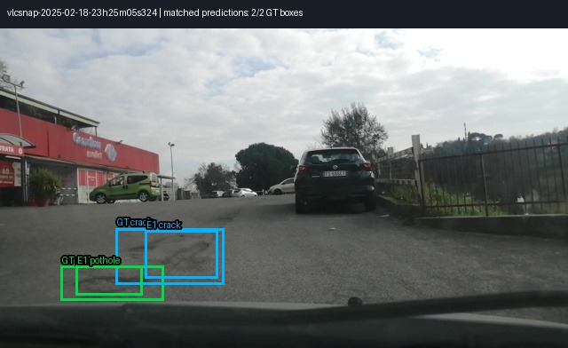
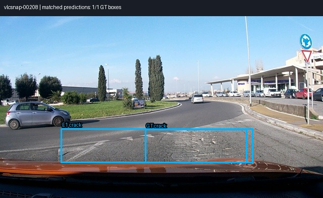
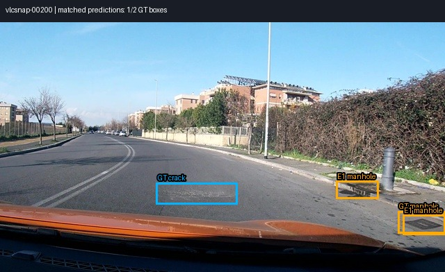
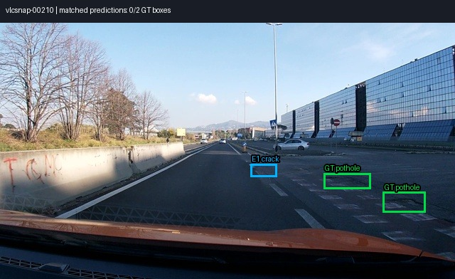
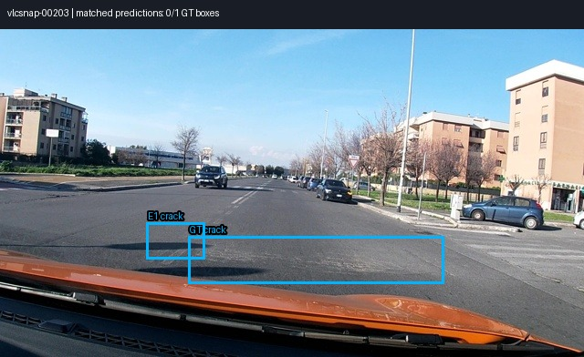
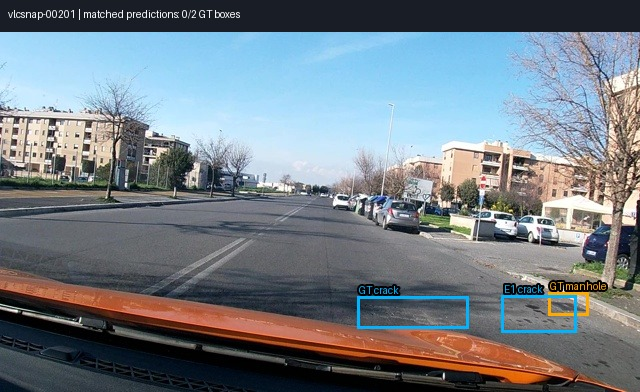

# Báo cáo Lab Day 10 — Qwen3-VL-4B

Người thực hiện: Hưng Đinh Bảo (Kaggle `hnginhbo`)  
`dataset_version`: `d10-21e4070301` (seed `day10`, salt 0)

## Bảng kết quả

| Mã | Setup | Tham số huấn luyện | VRAM đỉnh (GB) | Phút | F1 | CI95 | FP/ảnh | F1 pothole | F1 crack | F1 manhole |
|---|---|---:|---:|---:|---:|---|---:|---:|---:|---:|
| E0 | Zero-shot | 0 | — | — | 0.0873 | [0.0620, 0.1180] | 0.871 | 0.1560 | 0.0266 | 0.1867 |
| E1 | LoRA LLM, r=16, 300 bước | 33,030,144 | 7.675 | 26.29 | 0.2734 | [0.2363, 0.3129] | 1.029 | 0.1446 | 0.1981 | 0.5433 |
| E2 | LoRA LLM + projector FP32, r=16 | 87,609,344 | 6.556 | 30.18 | 0.0597 | [0.0394, 0.0851] | 1.363 | 0.0640 | 0.0278 | 0.1762 |
| E3 | E2 + LoRA ViT, r=16 | 93,900,800 | 7.902 | 35.38 | 0.0042 | [0.0010, 0.0087] | 4.186 | 0.0000 | 0.0050 | 0.0000 |
| E4-r4 | LoRA LLM, rank 4 | 8,257,536 | 7.052 | 30.21 | 0.2436 | [0.2085, 0.2830] | 1.209 | 0.1872 | 0.1690 | 0.4800 |
| E4-r64 | LoRA LLM, rank 64 | 132,120,576 | 8.151 | 30.84 | 0.2516 | [0.2164, 0.2930] | 1.232 | 0.1895 | 0.1739 | 0.5081 |

Số liệu lấy từ evidence JSON của một lượt Kaggle T4, mỗi setup huấn luyện 300 bước; E0 không huấn luyện. E1 tăng F1 0.1861 so với E0, vượt yêu cầu tối thiểu 0.10. Split chuẩn gồm 1,422 ảnh train, 276 val, 311 test. Số box pothole/crack/manhole lần lượt là train 1,074/1,750/691; val 66/470/103; test 121/299/163.

## 10 câu hỏi

### Câu 1 — Kiến trúc và tham số

Theo quy mô xấp xỉ trong hướng dẫn, LLM có 4.0B tham số, ViT 415M, projector/merger 109M (visual merger khoảng 27M và deepstack mergers khoảng 82M), tổng gần 4.44B. Đây là số xấp xỉ theo khối. E1 dùng LoRA trên 252 module LLM; E2 mở projector/merger FP32 cùng LoRA LLM; E3 bổ sung LoRA trên 96 module ViT, tổng 348 module LoRA mục tiêu.

### Câu 2 — E0

`parse_valid_rate` E0 là 0.9357 (291/311 parse được). Hai lỗi rõ nhất là JSON sai cấu trúc (20 output không parse được, gồm trường hợp thiếu dấu đóng hoặc lặp key `bbox_2d`) và định vị không đúng: 544 FN cùng 271 FP trên toàn test. Ví dụ output thô của `vlcsnap-00205` là `[{"bbox_2d":[10,467,998,997],"label":"crack"}]`, box phủ gần hết nửa dưới ảnh và bỏ sót một trong hai crack thật. 

### Câu 3 — Thang 0–1000

Tọa độ chuẩn hóa độc lập độ phân giải; khi vẽ/chấm, x được đổi theo chiều rộng và y theo chiều cao. Chấm nhầm output E1 thang norm1000 như pixel làm F1 giảm từ 0.2734 xuống 0.0000 trên cùng test set. Mình xác nhận bằng cách chấm lại `work/e1_test.jsonl` với `--coord pixel`; box bị co về gần góc trên trái sau phép quy đổi. Với `norm1000`, F1 là 0.2734.

### Câu 4 — Mask loss

Chỉ tính loss trên câu trả lời của assistant. Prompt là đầu vào điều kiện, token ảnh biểu diễn nội dung thị giác; học dự đoán lại chúng không giúp mục tiêu grounding và làm chuỗi đầu vào dài lấn át mục tiêu JSON. Vì vậy mask prompt và padding bằng `-100`, chỉ JSON đáp án và token kết thúc đóng góp loss.

### Câu 5 — Projector và lượng tử hóa

Projector ánh xạ đặc trưng ViT sang biểu diễn LLM. Projector lượng tử 4-bit bị đóng gói/đóng băng, không thể cập nhật đầy đủ theo E2; LoRA không tương đương mở toàn bộ trọng số. Pipeline giữ nhánh visual không lượng tử hóa và đưa projector được mở về FP32 để cập nhật ổn định. Do lỗi dtype FP16 với AdamW, lượt Kaggle dùng master parameters và trạng thái optimizer FP32 rồi đồng bộ trọng số về model.

### Câu 6 — Chia theo session

Frame liền kề từ cùng video gần như trùng cảnh. Chia ngẫu nhiên từng ảnh có thể đưa frame gần giống nhau vào train và test, gây rò rỉ và F1 lạc quan. Chia theo session giữ nguyên phiên quay trong một split và kiểm tra khả năng khái quát sang cảnh khác. Box theo split: train 1,074/1,750/691; val 66/470/103; test 121/299/163 (pothole/crack/manhole). Meta tái tạo khớp `d10-21e4070301`.

### Câu 7 — E1/E2/E3

E1 tốt nhất: F1 0.2734, CI95 [0.2363, 0.3129], 7.675 GB, 26.29 phút. E2 tụt xuống 0.0597 [0.0394, 0.0851] dù tốn 30.18 phút; recall chỉ 0.053. E3 còn thấp hơn, F1 0.0042 [0.0010, 0.0087], VRAM 7.902 GB, 35.38 phút; nó tạo nhiều box crack dạng lát lặp lại, dẫn tới 1,302 FP và 4.187 FP/ảnh. Vì thế trong lần chạy này, mở projector hoặc thêm LoRA ViT không đáng chi phí và không cải thiện chất lượng. Đây là kết quả của đúng cấu hình/seed này; cần kiểm tra thêm LR và target modules trước khi quy kết rằng các khối đó vốn không hữu ích.

### Câu 8 — CI và test set

CI95 E1 rộng 0.0766 [0.2363, 0.3129]; E0 rộng 0.0560 [0.0620, 0.1180]. Test 311 ảnh còn nhỏ và bootstrap theo ảnh không loại bỏ khác biệt giữa session/lớp. Chênh E1−E0 là 0.1861, hai CI không chồng lấn trên split này, là bằng chứng cải thiện rõ trên split cố định nhưng chưa đảm bảo cùng mức tăng trên tuyến đường mới. CI E2/E3 cũng tách khỏi E1; E3 có hiện tượng suy giảm rất lớn nên cần kiểm tra lỗi triển khai/hội tụ trước khi khái quát kết luận.

### Câu 9 — Lỗi theo lớp

E1 yếu nhất ở pothole: F1 0.1446 (12 TP, 33 FP, 109 FN); crack đạt 0.1981; manhole 0.5433. Test có 121 pothole, ít hơn crack (299); median box pothole khoảng 7.19% chiều rộng × 6.11% chiều cao nên sai lệch nhỏ dễ làm IoU thấp hơn 0.5. Crack có 299 box nhưng dễ lẫn với vân mặt đường, có 265 FP. Manhole có hình dạng ổn định hơn, precision 0.758 và recall 0.423. Sáu hình overlay nhãn thật và dự đoán E1:

Ba hình đầu có box khớp theo IoU≥0.5; ba hình sau minh họa lỗi và bỏ sót.

Box được ghi tiền tố GT hoặc E1 và tên lớp. Màu phân biệt lớp: pothole xanh lá, crack xanh dương, manhole cam.

### Câu 10 — E4

E4 chỉ đổi rank LoRA so với E1 (r=16): r=4 và r=64, alpha=2r; các yếu tố còn lại giữ nguyên. Rank 4 đạt F1 0.2436 [0.2085, 0.2830], 7.052 GB, 30.21 phút với 8.26M tham số trainable. Rank 64 đạt 0.2516 [0.2164, 0.2930], 8.151 GB, 30.84 phút với 132.12M tham số. Hai CI chồng lấn đáng kể với E1 và với nhau; khác biệt rank 4/64 chỉ 0.0080, nên test này chưa cho bằng chứng rank cao tốt hơn. Rank 4 tiết kiệm VRAM và tham số, còn E1 rank 16 vẫn đạt F1 cao nhất.

## Nhìn lại

Lỗi kỹ thuật ban đầu là dtype không tương thích giữa autocast FP16, gradient FP32 và AdamW khi mở projector. Giải pháp là giữ master parameters và optimizer state ở FP32, chép gradient sang master tensor để cập nhật rồi đồng bộ về dtype model. Các lượt đã hoàn tất, nhưng E2/E3 giảm mạnh so với E1; riêng E3 lặp nhiều box crack sai. Vì vậy báo cáo ghi nguyên kết quả và xem E1 là setup tốt nhất trong lần chạy này, thay vì che đi ablation âm.
